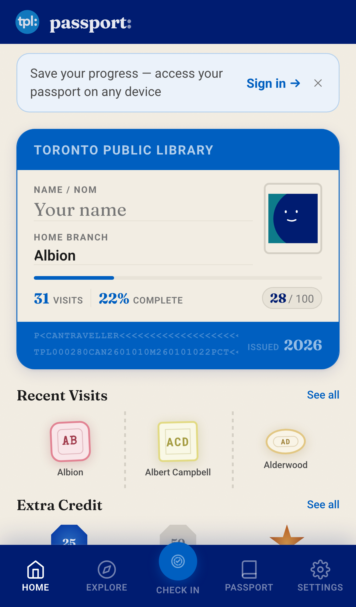
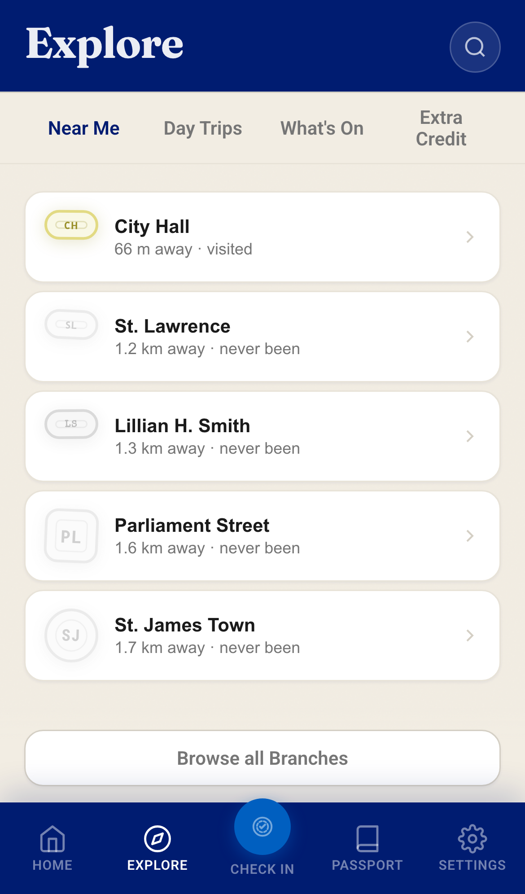
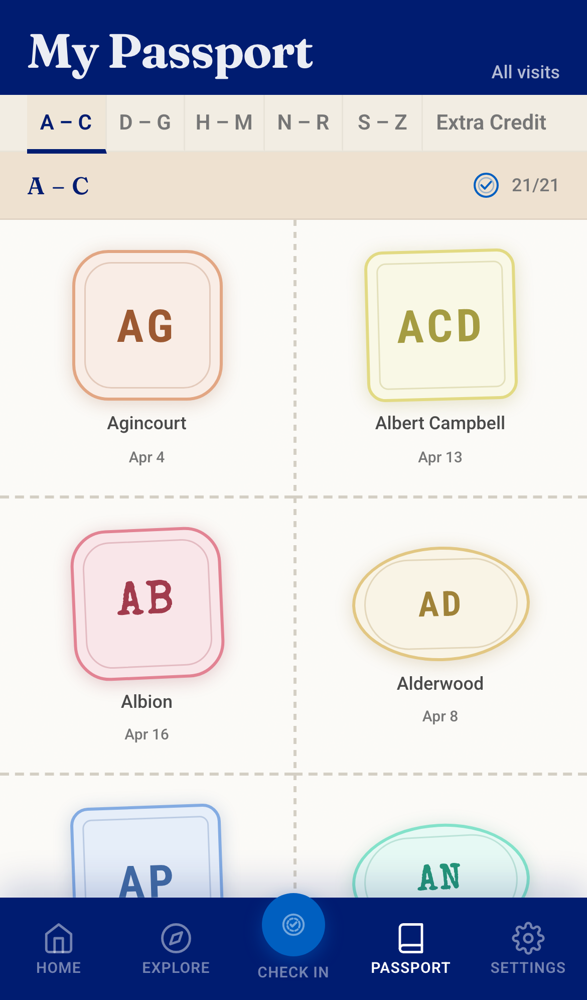
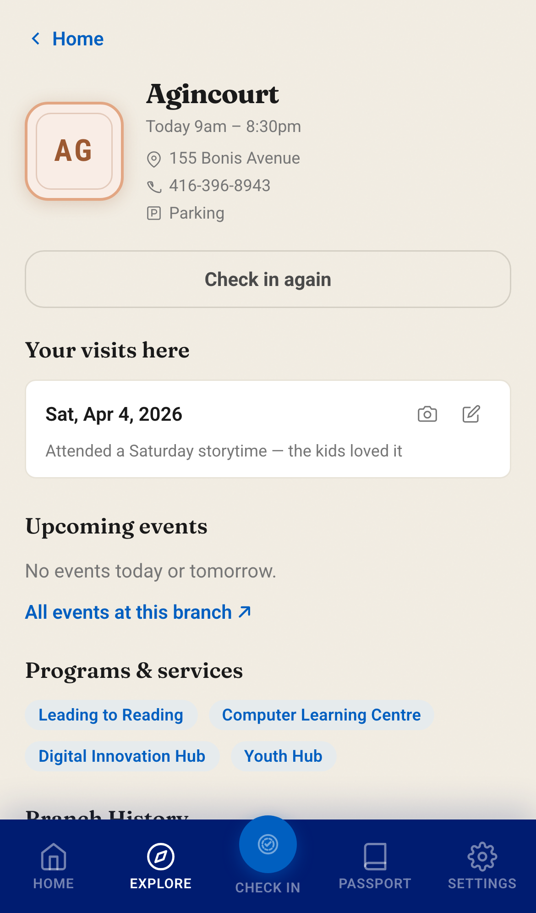

# TPL Passport

A mobile-first stamp-collecting app for the Toronto Public Library. Visit branches, collect stamps, earn badges, and fill your passport.

  
  
  
  

_Screenshots are representative and may lag the current UI._

## Try it

Open the app on your phone for the best experience — it's designed as a mobile PWA and can be added to your home screen.

## What's in the app

| Screen | Description |
|--------|-------------|
| **Home** | On a first visit, two panels: check in and make your passport. After that, passport progress, recent visits, and earned badges; sign-in prompt for logged-out users |
| **Explore** | Four tabs: nearby branches, day trips (walking routes, and the Your Library Tour transit routes), upcoming events, and badge suggestions |
| **Check In** | Finds the nearest branch and checks you're within 100 m, then stamps your passport. Or pick any branch and day, up to today. The first stamp gets its own page |
| **Passport** | Stamp book across 5 alphabetical pages + an Extra Credit page for badges |
| **History** | Check-in log grouped by recency; filter to visits with notes or photos |
| **Branch detail** | Branch info, hours, events, services, and your visits with notes and photos |
| **All branches** | A–Z directory of every branch with search and visited/unvisited filters |
| **Day trip** | A curated multi-branch route with its stops and a one-tap Google Maps link |
| **Library Tour route** | One of the ten [Next Stop: Your Library Tour](https://schoolofcities.utoronto.ca/opportunities/next-stop-your-library-tour/) transit routes: its ten branches, your progress, and the TTC rides between stops |
| **Settings** | Sign in/out, theme picker (Light / Auto / Dark), install helper, dev-only demo mode |
| **QR Print** | Printable branch QR codes for check-in campaigns |

## Stack

- **Nuxt 4** in SPA mode (`ssr: false`), written in **TypeScript** (`<script setup lang="ts">` throughout)
- **Pinia** for state, persisted to `localStorage`; check-in photos are kept on the device in IndexedDB
- **Auth service** ([tpl-passport-auth](https://github.com/manic-mechanic/tpl-passport-auth), a Cloudflare Worker at `auth.librarypassport.ca`): email/password and Google sign-in via Better Auth, plus cross-device sync of check-ins, profile and photos (stored in Cloudflare R2). The app works fully signed out; signing in uploads what's on the device
- **Nitro server routes** (`server/api/`) proxy TPL events from Toronto Open Data
- **Sentry** for errors (hidden source maps are uploaded at build time) and **PostHog** for product analytics
- **Vercel** for hosting

Branch, hours and route data is static JSON in `packages/shared/data/`, sourced from the [Toronto Open Data](https://open.toronto.ca/) portal. `packages/shared` also holds the pure logic (badges, stamps, regions, the library-day rule) shared with the auth service and the native app.

## Environments

Production is [www.librarypassport.ca](https://www.librarypassport.ca), deployed from `main`. Every PR gets a Vercel preview.

Configuration is in `.env.example`. `NUXT_PUBLIC_IS_DEV` turns on the dev-only UI (demo mode, location-check bypass toggle, QR scanner); `NUXT_PUBLIC_BYPASS_GEOFENCE` only takes effect when it's on.

## Commands

- `npm run dev` — start local development server
- `npm test` — run tests once
- `npm run test:watch` — run tests in watch mode
- `npm run test:e2e` — run Playwright end-to-end regression tests
- `npm run lint` — run ESLint checks
- `npm run lint:fix` — auto-fix lint issues where possible
- `npm run build` — build for production
- `npx nuxi typecheck` — type-check the app and server

CI runs lint, typecheck, unit tests, a production build and the Playwright suite on every PR and on `main`.
